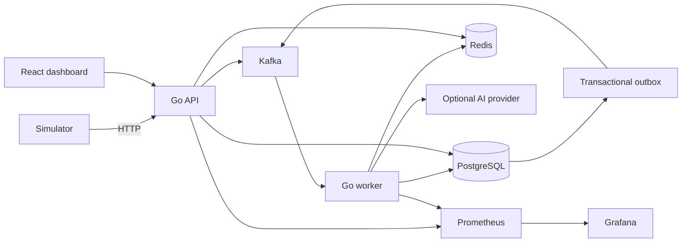

# NetPulse AI

Real-time network observability with deterministic incident detection and optional AI-assisted investigation. Simulated routers send telemetry through a Go ingestion API and Kafka; a worker persists rolling metrics, detects anomalies, and updates a live-polling React dashboard.

**Implementation status:** the application, local stack configuration, test suites and cloud deployment configuration are present. Unit tests and frontend checks can run independently of Docker. Full-stack and cloud verification are recorded separately in [docs/verification.md](docs/verification.md); neither is claimed deployed. The test results below refer to the recorded implementation run, not a new run during this documentation update.

## Start here

- [Use cases](#what-this-project-is-for)
- [What has been implemented](#what-has-been-implemented)
- [Recommended code-reading order](#how-to-understand-the-code-recommended-reading-order)
- [Quick start](#quick-start)
- [Local testing and expected results](#local-testing-commands-and-expected-results)
- [Google Cloud deployment](#how-to-deploy-to-google-cloud)
- [Post-deployment tests](#what-to-test-after-deployment)
- [Operations and updates](#operating-and-updating-the-deployment)
- [Troubleshooting](#troubleshooting)
- [Known limitations](#known-limitations)

## What this project is for

NetPulse AI helps you answer three questions: **Which device is unhealthy? What changed? What should I investigate next?** It receives measurements such as latency and packet loss, detects sustained problems, and records incidents that an operator can acknowledge or resolve.

The current data source is a simulator. It does not discover physical routers or collect SNMP, ping, or flow data from your network. A real-device deployment would need a collector that translates those measurements into this project's telemetry schema and calls its ingestion API.

| Use case | How to try it | What you should see |
|---|---|---|
| Detect slow network responses | Run `latency-spike` | One high-latency incident after sustained breaches; its observation count increases |
| Investigate unreliable links | Run `packet-loss` | A packet-loss incident and elevated loss in the chart |
| Detect resource pressure | Run `high-cpu` | A CPU incident after the configured number of samples |
| Identify missing devices | Run `device-offline` longer than the offline timeout | The selected router becomes offline and an offline incident appears |
| Practice incident management | Open an incident, acknowledge it, then resolve it | Lifecycle changes persist in PostgreSQL and appear in the dashboard |
| Understand automatic recovery | Let a scenario finish while keeping the simulator running | Healthy observations eventually resolve the active incident |
| Explore advisory analysis | Enable the mock provider | Clearly labeled demo analysis with facts, hypotheses and investigation steps |
| Learn backend/platform engineering | Trace one event through API → Kafka → worker → database | A working example of asynchronous processing, deduplication and observability |

Memory, bandwidth and instability rules are also implemented, but there are no named simulator scenarios for them. Test them with suitable API telemetry or focused tests; bandwidth detection requires device capacity to be configured.

## What has been implemented

| Area | Implemented behavior | Start reading here |
|---|---|---|
| API | Registration, input validation, batch ingestion, queries, incident actions, authentication, CORS and rate limits | [internal/httpapi/api.go](internal/httpapi/api.go) |
| Telemetry processing | Event-ID deduplication, minute aggregates, current health and historical-event handling | [internal/database/process.go](internal/database/process.go) |
| Detection | Sustained metric thresholds, severity ratios, cooldown, recovery, offline checks and instability | [internal/anomaly/rules.go](internal/anomaly/rules.go), [process.go](internal/database/process.go) |
| Messaging | Device-keyed Kafka publishing, consumer groups, retries, DLQs and explicit commits | [internal/messaging/kafka.go](internal/messaging/kafka.go) |
| Persistence | Tables, indexes, incident queries, migrations and transactional outbox | [migrations/001_init.sql](migrations/001_init.sql), [internal/database](internal/database) |
| Cache | Latest-device state, TTL, stale-write protection and database fallback | [internal/cache/cache.go](internal/cache/cache.go) |
| AI | Disabled/mock/compatible-provider modes, validated JSON and leased analysis jobs | [internal/ai/provider.go](internal/ai/provider.go), [outbox.go](internal/database/outbox.go) |
| UI | Overview counts, device charts, incident details, lifecycle actions and demo guide | [web/src/App.jsx](web/src/App.jsx) |
| Operations | Containers, local orchestration, Prometheus metrics, Grafana provisioning and cloud deployment files | [docker-compose.yml](docker-compose.yml), [deploy](deploy) |
| Quality | Go and frontend tests, integration test suite, OpenAPI and GitHub Actions | [tests/integration](tests/integration), [.github/workflows/ci.yml](.github/workflows/ci.yml) |

**Implemented does not mean deployed or fully acceptance-tested.** The earlier implementation run recorded passing Go tests/build/vet, five frontend tests, frontend lint/build and dependency scans. Docker-backed tests, visual browser inspection and cloud deployment were not verified in that run. This README update does not rerun those checks or turn that historical record into a current result. See [the verification record](docs/verification.md).

## How to understand the code: recommended reading order

Follow one telemetry event through the system before trying to read every file.

| Step | Read | Understand before moving on |
|---|---|---|
| 1. Product and requirements | This README, then [the project specification](NetPulse_AI_Project_Spec.md) | The problem being solved and the difference between detection and AI advice |
| 2. Data shapes | [internal/domain/model.go](internal/domain/model.go) | Device, event, metrics and incident fields; UUIDs; validation |
| 3. Configuration | [.env.example](.env.example), [internal/config/config.go](internal/config/config.go) | Thresholds, recovery windows, dependencies and disabled AI behavior |
| 4. Storage | [migrations/001_init.sql](migrations/001_init.sql), [store.go](internal/database/store.go) | Which table owns each piece of state and why unique indexes matter |
| 5. Request entry | [cmd/api/main.go](cmd/api/main.go), [internal/httpapi/api.go](internal/httpapi/api.go) | How the API validates a request and publishes telemetry |
| 6. Kafka delivery | [internal/messaging/kafka.go](internal/messaging/kafka.go) | Keys, consumer groups, retries, offset commits and dead-letter messages |
| 7. Processing and rules | [cmd/worker/main.go](cmd/worker/main.go), [process.go](internal/database/process.go), [rules.go](internal/anomaly/rules.go) | How one transaction deduplicates, aggregates and changes incidents |
| 8. Reliability helpers | [outbox.go](internal/database/outbox.go), [cache.go](internal/cache/cache.go) | How publishing and caching failures are handled |
| 9. AI | [internal/ai/provider.go](internal/ai/provider.go) | What context is sent, how output is validated, and why it cannot control severity |
| 10. Frontend | [web/src/api.js](web/src/api.js), [web/src/App.jsx](web/src/App.jsx), [styles.css](web/src/styles.css) | Fetching, five-second polling, charts, actions and error states |
| 11. Tests and operations | Corresponding `*_test.go` files, [integration tests](tests/integration/pipeline_test.go), Compose and CI | How each behavior is verified and how services start together |

A useful exercise: find `POST /api/v1/telemetry` in the API, follow `Publish` into Kafka, then follow the worker's `Consume` callback into `Store.Process`. Locate the event insert, anomaly evaluation and incident update. Finally, find the dashboard request that reads those results.

Important distinctions:

- **202 Accepted** means Kafka acknowledged the event; the worker may still be processing it.
- **Idempotent processing** means retrying the same event ID does not apply the database change twice.
- **Outbox** means a notification is saved in the same database transaction as its incident and published afterward.
- **Redis is a cache**; PostgreSQL remains the source of truth.
- **AI analysis jobs are claimed from PostgreSQL**; the Kafka analysis topic is a notification stream.
- **Telemetry charts show minute averages**, so a short spike may look smaller than individual samples.

If you change a feature, start with its domain/rule code, update the persistence/API path if needed, add a behavior-focused test, then update the UI and API documentation. For schema changes, add a new numbered migration and extend the migration runner; do not edit an already-applied migration and expect it to run again.

## Features

- Go API, worker and configurable simulator with graceful shutdown and structured logs.
- Kafka ingestion, per-device partition keys, bounded retries, dead-letter queues and explicit offset commits.
- Atomic PostgreSQL event deduplication, minute aggregates, incident lifecycle and transactional outbox.
- Sustained latency, packet loss, CPU, memory, bandwidth utilization, offline and instability rules.
- Redis latest-state cache with TTL, stale-write protection and database fallback.
- Device/incident APIs, pagination, filters, lifecycle actions and [OpenAPI 3.1](docs/openapi.json).
- React overview, device telemetry, incident investigation, analysis status and demo guide.
- Optional mock or OpenAI-compatible structured analysis; operation without credentials.
- Prometheus metrics, provisioned Grafana dashboard, CI and isolated integration tests.

## Architecture



The API, worker and simulator share small internal packages. PostgreSQL is authoritative; Redis does not determine correctness. Delivery is **at least once with idempotent persistence**, not end-to-end exactly once. Detection and severity are deterministic. AI only provides advisory explanations.

## Quick start

Requires Docker Engine/Desktop, Docker Compose v2.24+, and `make` for the shortcuts, approximately 4 CPUs and 6 GB available memory. No Go, Node, cloud account or AI key is needed for the Compose path.

```sh
make setup          # copy .env.example if .env does not exist
make up             # build, migrate, initialize topics, start services
make seed           # register 10 demo routers
make demo           # normal → latency spike → normal recovery
```

| Service | URL | Local credentials |
|---|---|---|
| Dashboard | http://localhost:5173 | None by default |
| API readiness | http://localhost:8080/readyz | None |
| API metrics | http://localhost:8080/metrics | None |
| Prometheus | http://localhost:9090 | None |
| Grafana | http://localhost:3000 | `admin` / `local-demo-change-me` |

Published ports bind to loopback. PostgreSQL, Redis and Kafka are private to the Compose network. The default credentials are strictly for local development.

```sh
make logs           # API and worker logs
make down           # stop stack; preserve data
make migrate        # apply pending migration
```

`docker compose down -v` is **destructive**: it deletes local persistent data. `make clean` only prints this command.

## Local testing: commands and expected results

Run these commands from the **NetPulseAI project root**, where `docker-compose.yml` is located. Docker Desktop/Engine must be running. macOS users can install Apple's Command Line Tools if `make` is unavailable, or use the direct Docker commands below. The existing stack uses host ports 5173, 8080, 9090 and 3000; stop conflicting services first.

### 1. Start and inspect the stack

```sh
docker --version
docker compose version
# Preserve an existing .env; create it only if missing.
test -f .env || cp .env.example .env
docker compose up -d --build --wait
docker compose ps -a
curl --fail http://localhost:8080/healthz
curl --fail http://localhost:8080/readyz
```

Expected: long-running application services are running, API/worker health checks pass, and `migrate` and `kafka-init` have exited successfully with code 0. Those two are one-time setup jobs, so they should not keep running. `/healthz` returns `{"status":"ok"}`; `/readyz` returns `{"status":"ready"}` when PostgreSQL and Kafka are reachable. Readiness does not prove that the entire telemetry pipeline has completed successfully.

### 2. Run automated checks

```sh
# Infrastructure integration tests; uses a separate netpulse_test database.
sh scripts/integration.sh

# Basic HTTP/metrics checks and demo device registration.
sh scripts/smoke.sh
```

The integration suite tests API/database persistence, Kafka publication/consumption, duplicate events, incident lifecycle, DLQ behavior and Redis fallback. These commands need Docker; they are distinct from the Go unit tests. The smoke script assumes the default local configuration with no API token and checks basic availability, not the full incident workflow.

For source-level checks, install the Go/Node versions described under [Development and tests](#development-and-tests), then run:

```sh
go test ./...
go vet ./...
go build ./cmd/...
(cd web && npm ci && npm run lint && npm test && npm run build)
```

The parentheses keep your terminal in the project root afterward. If macOS reports a missing C toolchain, install Command Line Tools; for ordinary Go tests/builds you can alternatively use `CGO_ENABLED=0`. Race tests require the C toolchain.

### 3. Verify the complete user workflow

In terminal A:

```sh
docker compose run --rm simulator -url http://api:8080 -seed-only
docker compose run --rm simulator -url http://api:8080 -scenario latency-spike
```

Keep it running. In terminal B:

```sh
curl --fail --silent http://localhost:8080/api/v1/summary
curl --fail --silent 'http://localhost:8080/api/v1/devices?limit=20'
curl --fail --silent 'http://localhost:8080/api/v1/incidents?status=open'
```

These API examples assume the default local `API_TOKEN` is empty. If you set it, include `-H "Authorization: Bearer $API_TOKEN"` after loading the token into your shell securely.

Use the dashboard and check each outcome:

- [ ] Ten demo routers are registered; fresh telemetry changes them from initially offline to online.
- [ ] `router-001` develops a latency incident after the sustained spike starts.
- [ ] Additional spike samples increase the **same incident's** occurrence count.
- [ ] Acknowledging it changes its status without creating another incident.
- [ ] With AI disabled, the analysis state is clearly unavailable; the rest of the application works.
- [ ] Leaving normal traffic running for the recovery window resolves the incident automatically. Do not manually resolve it if you are testing automatic recovery.
- [ ] On a separate incident, manual resolution works. Allow the cooldown to expire before expecting the same device/type to open a new incident.
- [ ] Grafana and Prometheus show ingestion/processing activity.

The simulator's `-duration` controls the anomalous period, **not the process lifetime**. It continues normal telemetry afterward until you press Ctrl+C. Run only one simulator during this walkthrough. Stopping every simulator causes devices to become offline after their timeout, which is expected.

### 4. Inspect persisted state and metrics

```sh
docker compose exec -T postgres psql -U netpulse -d netpulse \
  -c 'SELECT name,status,last_seen_at FROM devices ORDER BY name;'
docker compose exec -T postgres psql -U netpulse -d netpulse \
  -c 'SELECT type,status,occurrence_count FROM incidents ORDER BY created_at DESC LIMIT 10;'
curl --fail --silent http://localhost:8080/metrics
```

In Prometheus, try `netpulse_telemetry_events_received_total`, `netpulse_telemetry_events_processed_total`, and `netpulse_open_incidents`. The worker metrics are scraped internally; no host port is published for the worker. A nonzero processed count and stored telemetry are stronger evidence than an HTTP 202 response alone.

### 5. Stop safely

Stop the simulator with Ctrl+C, then run `docker compose down` to preserve named-volume data. Use `docker compose down -v` only when you intentionally want to erase all local state.

## Demo walkthrough

1. Run `make up` and `make seed`.
2. Start `make demo`. Open the dashboard and select `router-001`.
3. After 15 seconds of baseline traffic, latency rises for 90 seconds.
4. After five breached observations, one high-latency incident opens. Repeated breaches increase its count.
5. Open the incident. Acknowledge it, inspect observed metrics, and see `analysis unavailable` with default settings.
6. Normal telemetry resumes automatically. After two continuous healthy minutes, the incident resolves.
7. In Grafana, open **NetPulse AI · Operations** to inspect ingestion, processing, failures, active incidents and service health.
8. Stop the simulator with Ctrl+C. Devices eventually transition offline and generate offline incidents.

Run only one simulator at a time so normal traffic does not interrupt another process's scenario. Alternatives:

```sh
docker compose run --rm simulator -url http://api:8080 -scenario normal
docker compose run --rm simulator -url http://api:8080 -scenario packet-loss -target 2 -duration 90s
docker compose run --rm simulator -url http://api:8080 -scenario high-cpu -target 3
docker compose run --rm simulator -url http://api:8080 -scenario device-offline -target 1 -duration 90s
```

Flags include `-devices`, `-interval`, `-seed`, `-target`, `-warmup`, `-duration`, `-seed-only`, and `-url`. The simulator uses the same registration/ingestion API as other clients. It reuses event IDs on retries.

**Screenshots:** intentionally not fabricated. Capture your own running overview and incident detail after completing this scenario.

## AI configuration

The default is disabled. For deterministic, clearly labeled demo analysis:

```dotenv
AI_ENABLED=true
AI_PROVIDER=mock
```

For a compatible paid provider:

```dotenv
AI_ENABLED=true
AI_PROVIDER=openai-compatible
AI_BASE_URL=https://api.openai.com/v1
AI_API_KEY=your-secret-key
AI_MODEL=your-supported-model
AI_TIMEOUT=20s
```

Choose a model supporting the structured JSON schema used by `/chat/completions`. Recreate both services after changing `.env`:

```sh
docker compose up -d --force-recreate api worker
```

New incidents queue analysis automatically. Existing unavailable/failed analyses can be requested from incident details. Completed results deduplicate further requests. Missing credentials while AI is disabled are normal; inconsistent enabled configuration fails startup. Provider failures do not prevent ingestion or incident actions. Provider keys never enter the browser. [Provider contract and safety design](docs/architecture.md#ai-work).

## Configuration reference

All supported variables and defaults are in [.env.example](.env.example). Empty optional strings are allowed. Durations use Go syntax such as `30s`, `2m`, `168h`.

| Settings | Purpose/default |
|---|---|
| `APP_ENV`, `API_ADDR`, `LOG_LEVEL` | `local`, `:8080`, `info`; `debug` enables debug logs |
| `DATABASE_URL` | PostgreSQL DSN; Compose supplies its internal host |
| `REDIS_ADDR`, `REDIS_PASSWORD`, `REDIS_DB` | Cache connection; DB 0 |
| `CACHE_TTL` | Latest-state TTL, 30s |
| `KAFKA_BROKERS`, `KAFKA_CONSUMER_GROUP` | Comma-separated brokers; `netpulse-worker` |
| `KAFKA_*_TOPIC` | Five topic names; keep Compose init in sync |
| `KAFKA_TLS`, `KAFKA_USERNAME`, `KAFKA_PASSWORD` | TLS and SASL/PLAIN credentials |
| `CORS_ORIGIN`, `API_TOKEN` | Exact frontend origin; optional local bearer token |
| `LATENCY_THRESHOLD_MS`, `PACKET_LOSS_THRESHOLD_PCT` | 150 ms, 5% |
| `CPU_THRESHOLD_PCT`, `MEMORY_THRESHOLD_PCT` | 90%, 90% |
| `BANDWIDTH_THRESHOLD_PCT` | 90% of configured capacity |
| `SEVERITY_HIGH_MULTIPLIER`, `SEVERITY_CRITICAL_MULTIPLIER` | Threshold ratios 1.25 and 2; remaining breaches are medium |
| `ANOMALY_WINDOW`, `ANOMALY_MIN_SAMPLES` | 60s, 5 sustained observations |
| `DEVICE_OFFLINE_TIMEOUT` | 60s; maintenance checks every 10s |
| `INSTABILITY_TRANSITIONS` | 4 state transitions within the anomaly window |
| `INCIDENT_COOLDOWN`, `RECOVERY_WINDOW` | 5m after resolution, 2m healthy recovery |
| `TELEMETRY_RETENTION` | 168h; minimum 24h |
| `AI_ENABLED`, `AI_PROVIDER` | false, mock |
| `AI_BASE_URL`, `AI_API_KEY`, `AI_MODEL`, `AI_TIMEOUT` | Provider settings; 20s timeout, maximum 90s |

Non-local mode requires Kafka TLS and an API token of at least 32 characters. Token protection covers read and write APIs. Enter the token through the dashboard's connection form; it remains in memory and is cleared on reload.

## Development and tests

For host development, install Go 1.27.1 and Node.js 22.23.3 (or compatible supported versions). Dependencies are pinned in `go.mod`/`go.sum` and `web/package-lock.json`. A `web/go.mod` boundary keeps Go tooling out of JavaScript dependencies. `.tools/` is ignored and only used for build tools on the implementation machine.

```sh
go test ./...
go vet ./...
go build ./cmd/...
cd web
npm ci
npm run lint
npm test
npm run build
```

Or `make test` / `make lint` after installing dependencies. `go test -race ./...` requires a C toolchain. Local integration tests use a separate `netpulse_test` database:

```sh
make integration
```

Tests cover validation, sustained thresholds, window expiry, retry bounds, API authentication/errors, provider parsing/timeouts, Redis hit/miss/expiry/outage, and integration scenarios for database idempotency/lifecycle, Kafka delivery and DLQ. Integration tests have the `integration` build tag and never require a paid API. See [verification details](docs/verification.md).

`sh scripts/load-test.sh` sends a configurable bounded load through the simulator; it is not a benchmark claim. Stop existing simulators first.

## Project layout

```text
cmd/           api, worker, simulator, migrate executables
internal/      domain, config, anomaly, database, messaging, cache, ai, httpapi, app, metrics
migrations/    embedded numbered PostgreSQL schema
web/           React + Vite application and nginx image
deploy/       monitoring provisioning and cloud deployment files
docs/          architecture, API/OpenAPI, deployment, verification
tests/         infrastructure-backed integration suite
scripts/       seed, load, integration and smoke commands
.github/       CI workflow
```

## How to deploy to Google Cloud

The supplied target is **one Compute Engine VM** running the API, background worker, frontend and HTTPS gateway. PostgreSQL and Redis use managed private-network services; Kafka comes from a compatible managed provider. This keeps the continuously running consumer on a VM. The cloud Compose file does **not** include the local PostgreSQL, Redis, Kafka, Prometheus or Grafana containers.

Use [docs/deployment.md](docs/deployment.md) for the detailed infrastructure, IAM, network, Kafka-topic and secret commands. Follow this order:

| Stage | Where | Action | Ready to proceed when |
|---|---|---|---|
| 1 | Laptop | Complete local unit/integration tests and the demo walkthrough | You have confirmed ingestion, a deduplicated incident and recovery |
| 2 | Google Cloud / laptop with `gcloud` | Select a billing-enabled project, region and budget; enable required APIs | Your operator can provision the documented services |
| 3 | Google Cloud | Create the VPC/private-services connection, Cloud SQL database/user, Redis, VM and runtime service account | The VM can reach the private database/cache |
| 4 | Kafka provider | Create a TLS + SASL/PLAIN cluster, credentials and all five topics | The VM can reach every advertised broker and authenticate |
| 5 | Secret Manager | Store `runtime.env` as `netpulse-runtime`; grant narrow runtime access | A numeric secret version is available |
| 6 | Laptop | Build and push app/frontend images to Artifact Registry | Both release images exist for the VM's CPU architecture |
| 7 | VM | Install Docker Compose and `gcloud`; copy deployment files; set release variables | The deployment script can read the secret and pull images |
| 8 | DNS / VM | Point your domain to the VM's reserved address, allow HTTPS, and run the deployment script | Migration succeeds and services become healthy |
| 9 | Browser / VM | Run the post-deployment checks below | Authentication, telemetry, incidents and recovery all work |

Do not use the local development database password in cloud configuration. The cloud environment needs your own `DATABASE_URL`, private `REDIS_ADDR`, Kafka connection/credentials, exact HTTPS `CORS_ORIGIN`, and an `API_TOKEN` of at least 32 characters. Keep AI disabled initially so deployment does not depend on a paid provider.

### Build images on your laptop

After creating the Artifact Registry repository and authenticating as described in the deployment guide:

```sh
export PROJECT_ID='your-project-id'
export REGION='asia-south1'
export RELEASE='release-001'
export APP_IMAGE="$REGION-docker.pkg.dev/$PROJECT_ID/netpulse/app:$RELEASE"
export WEB_IMAGE="$REGION-docker.pkg.dev/$PROJECT_ID/netpulse/web:$RELEASE"

gcloud auth configure-docker "$REGION-docker.pkg.dev"
docker buildx build --platform linux/amd64 -t "$APP_IMAGE" --push .
docker buildx build --platform linux/amd64 -t "$WEB_IMAGE" --push web
```

The image tags here must match those used on the VM. Use immutable digests or unique release tags when releasing updates.

### Start the release on the VM

Copy the `deploy/cloud/` directory to the VM, preserving that directory path. From its parent project directory, export your actual values:

```sh
export PROJECT_ID='your-project-id'
export REGION='asia-south1'
export RELEASE='release-001'
export APP_IMAGE="$REGION-docker.pkg.dev/$PROJECT_ID/netpulse/app:$RELEASE"
export WEB_IMAGE="$REGION-docker.pkg.dev/$PROJECT_ID/netpulse/web:$RELEASE"
export DOMAIN='your-actual-dashboard-domain'
export SECRET_VERSION='1'
# This reference uses the Cloud SQL Auth Proxy profile.
export COMPOSE_PROFILES='sqlproxy'
export SQL_CONNECTION_NAME='your-project-id:asia-south1:netpulse-db'

sh deploy/cloud/deploy.sh
```

These are placeholders, not existing resources. `SECRET_VERSION` must be a version you created. The proxy needs Cloud SQL Client permissions and private network access; the matching database URL uses `sqlproxy:5432`. The script fetches the secret to `/opt/netpulse/runtime.env`, pulls images, starts the optional proxy, runs migrations and starts the remaining services. It does **not** create your Google Cloud resources, install Docker, create Kafka topics, or configure DNS for you.

Keep these non-secret release variables in a private operator runbook or shell configuration; subsequent Compose commands need them too. Keep secret values in Secret Manager rather than in this README or Git.

Google Cloud documents VM container execution and secret-version access in its [container guide](https://docs.cloud.google.com/compute/docs/containers) and [Secret Manager CLI reference](https://docs.cloud.google.com/sdk/gcloud/reference/secrets/versions/access). The exact repository deployment procedure and prerequisites are in [our deployment guide](docs/deployment.md).

## What to test after deployment

Run the following in **staging first**. The simulator registers test devices and creates incidents; do not aim it at an unrelated production environment.

### 1. Check containers and internal readiness on the VM

Use the same release environment variables as the deployment:

```sh
docker compose -f deploy/cloud/compose.yml ps -a
docker compose -f deploy/cloud/compose.yml logs --tail=100 api worker migrate
docker compose -f deploy/cloud/compose.yml exec -T api \
  wget -qO- http://127.0.0.1:8080/readyz
```

Expected: migrations exited 0, app services are running, and readiness reports `ready`. The public gateway routes the frontend and `/api/`; `/readyz` and `/metrics` must be checked internally. A browser response at the public `/readyz` path is not a valid backend readiness test.

### 2. Check HTTPS and authentication

Open `https://YOUR_DOMAIN` in your browser. Test the API from a shell where `DOMAIN` and the **actual operator** `API_TOKEN` are already set securely:

```sh
curl --fail "https://$DOMAIN/"
# Expected HTTP status without credentials: 401.
curl --silent --output /dev/null --write-out '%{http_code}\n' \
  "https://$DOMAIN/api/v1/summary"
# Expected with valid credentials: JSON device/incident counts.
curl --fail -H "Authorization: Bearer $API_TOKEN" \
  "https://$DOMAIN/api/v1/summary"
```

Enter that operator token in the dashboard connection form. It is kept in browser memory, so reloading may require entering it again. This is the NetPulse operator token, not an AI provider key.

### 3. Send telemetry through the deployed HTTPS endpoint

On a machine with Go and this source checkout, set `DOMAIN` and `API_TOKEN`, then run:

```sh
go run ./cmd/simulator -url "https://$DOMAIN" \
  -devices 10 -scenario latency-spike -target 1 -duration 90s
```

Repeat the local acceptance checklist: devices appear, events are persisted, one incident accumulates observations, acknowledgement works, and normal traffic causes recovery. With AI disabled, unavailable analysis is expected. If AI is enabled later, confirm that analysis becomes completed or clearly failed without disrupting incident processing.

### 4. Check worker metrics, logs and persistence

On the VM:

```sh
docker compose -f deploy/cloud/compose.yml exec -T api \
  wget -qO- http://127.0.0.1:8080/metrics
docker compose -f deploy/cloud/compose.yml exec -T worker \
  wget -qO- http://127.0.0.1:8081/metrics
docker compose -f deploy/cloud/compose.yml logs --tail=100 worker
```

The cloud Compose file does not deploy Prometheus/Grafana. Configure an internal scraper/monitoring service if you want hosted dashboards; local dashboard URLs do not carry over automatically. Use your Kafka provider's consumer-group monitoring to check lag and DLQ traffic. Check Cloud SQL for the incident/aggregate records and verify backups are configured.

### 5. Confirm recovery after a controlled restart

While the staging simulator is running, restart the worker:

```sh
docker compose -f deploy/cloud/compose.yml restart worker
```

Verify that readiness returns, processing resumes and the existing active incident is updated rather than duplicated. This is a recovery exercise; it is not proof of exactly-once delivery or high availability.

Record the image digests/tags, secret version, test date, observations and any failures in your deployment notes. A successful HTML page load alone is not enough to declare the release verified.

## Operating and updating the deployment

- Check service health, Kafka lag/DLQs, processing failures, database capacity and outbox growth regularly. An outbox backlog can indicate Kafka publishing failures.
- Monitor VM, database, Redis and Kafka costs; stopping the application containers does not delete billable managed resources.
- Before an update, run tests and build images under a new release tag. Take a database backup before schema changes. Export the new image references and rerun the deployment script.
- To roll back application code, select the previous image references and compatible secret version, then rerun deployment. Schema rollback is separate; this repository has no automatic destructive down migration.
- To stop cloud app containers, use `docker compose -f deploy/cloud/compose.yml down`. Follow the deployment guide's teardown section to remove infrastructure and stop its billing.

## Troubleshooting

| Symptom | First check |
|---|---|
| `docker` or `make` not found | Install/start Docker; use direct Compose commands if `make` is unavailable |
| API readiness is 503 | Inspect migration, PostgreSQL and Kafka logs/connectivity |
| Dashboard loads but has no devices | Run the seed/simulator command and confirm its API URL |
| Telemetry accepted but charts stay empty | Check worker health/logs and Kafka consumer lag; 202 only confirms ingestion |
| No incident after a spike | Confirm target device, minimum samples and threshold; stop competing normal simulators; consider cooldown from earlier tests |
| Incident has not recovered | Keep normal telemetry running for the recovery window; check other unhealthy metrics |
| Device becomes offline after the demo | The simulator was stopped; no new heartbeat is arriving |
| HTTP 401 | Supply the configured NetPulse `API_TOKEN` |
| Browser origin denied | Set `CORS_ORIGIN` to the exact browser origin, including scheme and port where applicable |
| AI stays unavailable | AI is disabled; enable mock mode and recreate API/worker, then request analysis |
| Cloud metrics are not visible in Grafana | Cloud monitoring is not included in the cloud Compose file; provision an internal scraper |
| Cloud SQL connection fails | Check proxy profile, connection name, IAM, database credentials and private routing |

## Known limitations

[Google Cloud deployment instructions](docs/deployment.md) cover VM hosting, managed PostgreSQL/Redis/Kafka, secrets, HTTPS, image publishing, migrations, smoke checks, rollback and teardown. The cloud configuration is provided but not deployed. Review and execute infrastructure changes in your account.

- Shared bearer authentication is provided, not user accounts or RBAC. Keep health/metrics internal and add gateway identity controls for organizational use.
- Kafka is the only transport. Pub/Sub, WebSockets and outbound alerts are deferred optional enhancements.
- Current telemetry aggregates are minute means; raw events have configurable retention. Recovery conservatively requires all metric rules to be healthy.
- Redis health can lag by its TTL, particularly after offline checks or manual incident actions.
- Incident lists default to 24-hour creation ranges; use API date filters for older records. Global active counts include older incidents.
- Analysis is claimed from PostgreSQL; Kafka analysis topics are notifications. Provider retries after crashes may incur duplicate charges.
- Kafka lag export, per-user quotas, database partition retention, robust distributed maintenance scheduling and high-availability cloud failover remain follow-up hardening work.
- The initial schema has one forward migration; no destructive down migration is automated. Back up before future schema changes.

Suggested next work: run the full Docker acceptance suite, verify cloud deployment in a staging project, add OIDC/RBAC, export broker consumer lag, and introduce partition-based telemetry retention after load measurement.

[Architecture and sequence diagram](docs/architecture.md) · [API usage](docs/api.md) · [Deployment](docs/deployment.md)

## License

MIT; see [LICENSE](LICENSE).
