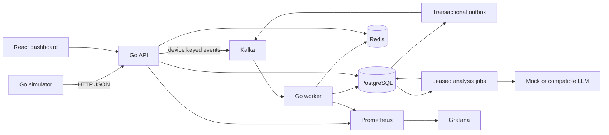

# Architecture and delivery semantics

NetPulse uses three Go executables: API, worker, simulator. A fourth executable runs numbered schema migrations. The React frontend is served by nginx, which proxies `/api` to the Go API. PostgreSQL is authoritative; Redis is optional for correctness. Kafka is the only implemented transport.



```mermaid
sequenceDiagram
 participant S as Simulator
 participant A as API
 participant K as Kafka
 participant W as Worker
 participant P as PostgreSQL
 participant R as Redis
 S->>A: Versioned telemetry (stable event_id on retry)
 A->>A: Validate batch and registered devices
 A->>K: Publish, key = device UUID
 K-->>A: Broker acknowledgement
 A-->>S: 202 Accepted
 K->>W: At-least-once delivery
 W->>P: Begin; lock device; insert unique event ID
 W->>P: Update minute sums, health, incidents, outbox
 P-->>W: Commit
 W->>R: Best-effort latest device cache
 W->>K: Commit offset
 W->>P: Claim outbox row
 W->>K: Publish incident/analysis notification
 W->>P: Delete outbox row after acknowledgement
```

## Persistence and ordering

`Process` locks the device row, inserts the unique event ledger entry, accumulates minute sums, evaluates rules, mutates incidents and creates outbox messages in one transaction. A duplicate event has no effect. Per-device locks protect multiple consumers and API registration is separate. Device IDs are UUIDs; `router-001` is a display name, resolving the inconsistent ID examples in the original specification.

Older/equal-timestamp observations contribute to minute aggregates but do not overwrite the current health or trigger rules. Window evaluation uses the latest N observations in the configured window. All N must exceed the threshold; equality is healthy. Every metric rule uses this noise filter. Capacity=0 means bandwidth utilization is unknown and no bandwidth rule is applied.

An active unique `(device_id,type)` index prevents duplicate incidents. Breaches update occurrence count and last seen, preserving acknowledgement. Severity is medium above the threshold, high at the configurable high multiplier (1.25), and critical at the critical multiplier (2). It can escalate but does not decrease within an incident. Recovery requires all configured measurements to remain healthy across the recovery window; an offline heartbeat gap resets recovery. This conservative policy resolves active incidents together. Manual resolution is immediate, but cached device health reflects the next telemetry evaluation or TTL expiry. The cooldown starts at resolution and suppresses creation for the same type.

Offline checking runs every 10 seconds. Devices that have never sent telemetry are eligible after their creation timeout. Transition history drives the instability rule. Single-node maintenance is intended for the MVP; maintenance locks skip devices being processed.

## Kafka and outbox

Five topics are explicitly initialized with three partitions, 24-hour retention, and development replication factor 1. Production should use replication factor 3 and min.insync.replicas=2. Producer acknowledgements use the client's all-ISR default. Telemetry records are keyed by device UUID. Incident notifications include a schema version and event UUID; analysis requests use incident ID as their idempotency key.

The worker group is configurable (`netpulse-worker`). Automatic commits are disabled. Rebalances are blocked only during the current record, with a 5-minute rebalance timeout. Processing attempts are bounded, with exponential backoff and jitter. Permanent invalid messages skip retries. Exhausted records are committed only after broker-acknowledged DLQ publication; commit or DLQ failures stop the worker so later offsets cannot skip failed work. Compose restarts the process.

The DLQ contains source topic, partition, offset, key, a sanitized reason, original JSON (or string), and failure time. Restrict access: original device data is retained in the DLQ. Retry valid transient failures by republishing the original event with its original event ID. Events older than the 24-hour acceptance horizon are rejected; historical backfill needs a separate trusted path.

Outbox delivery is at least once. A crash after publish but before row deletion can duplicate notifications. Consumers of these topics must deduplicate. There is no end-to-end exactly-once claim. Kafka consumer lag is not currently exported; use Kafka group tooling/managed broker monitoring in deployment.

## AI work

PostgreSQL `incident_analyses` is the durable job queue. Kafka analysis requests are integration/audit notifications, not a second authoritative queue. The worker polls pending rows, using `FOR UPDATE SKIP LOCKED`, a two-minute lease, per-claim generation fencing and at most three attempts with exponential retry eligibility. Exhausted leases are marked failed and routed to the analysis DLQ. Completed requests cannot be retriggered by repeated clicks. Failed/unavailable analyses can be requested again. Provider failures go to `incident-analysis-dlq` through the outbox.

Only incident type, deterministic severity, and up to 30 minute buckets leave the application. No device name, location, ID, credentials or raw device strings are sent. Output is constrained to JSON, validated for required fields and size, and rendered by React as text. AI does not mutate incident severity or lifecycle. `AI_ENABLED=false` stores `unavailable`; mock output explicitly identifies itself.

Provider requests use the compatible `/chat/completions` endpoint with JSON schema and token limits, following [official structured-output documentation](https://developers.openai.com/api/docs/guides/structured-outputs). Compatibility requires a provider/model supporting that schema contract. A crash after provider billing but before persistence can repeat a charge after lease expiry; no exactly-once billing guarantee is possible here.

## Cache and retention

`device:{UUID}:latest` holds a JSON device with latest metrics, status and fixed-width cache version. Default TTL is 30 seconds. A Lua compare-and-set prevents older cache fills from replacing newer states. Cache read errors, misses and expired entries fall back to PostgreSQL. Writes are best effort with a one-second timeout. Offline transitions and manual actions may remain stale until TTL expiry; device list queries always use PostgreSQL.

Minute aggregates retain sums and sample counts, returning averages. Events, minute buckets and transition history retain seven days by default. The event ledger retention must exceed the 24-hour acceptance horizon. Cleanup currently uses periodic SQL deletes; production high-volume deployments should adopt date partitions and bounded partition drops. Incidents and analyses are retained indefinitely for audit. Outbox rows remain until delivered; monitor its size during Kafka outages. Kafka retains events for 24 hours independently. Docker log rotation is configured for app containers.

## Operational boundaries

Local ports bind to loopback. Non-local startup requires a 32-character bearer token and Kafka TLS. The bearer token is shared operator authentication, not multi-user RBAC. The frontend accepts it in memory only and does not embed it in the build. PostgreSQL queries use parameters, requests have a 1 MiB limit, batches are capped at 100, and write requests use a process-wide 100 requests/sec token bucket (burst 200). Enforce per-user quotas at a gateway for public multi-tenant use.

Database and Kafka determine readiness. Redis failure does not fail readiness. All processes handle SIGTERM, stop intake and close clients. A database-committed record interrupted during shutdown is safely redelivered and deduplicated.
